<div align="center">

<picture>
  <source media="(max-width: 600px) and (prefers-color-scheme: dark)" srcset="docs/assets/hero-m-en-dark.svg">
  <source media="(max-width: 600px)" srcset="docs/assets/hero-m-en-light.svg">
  <source media="(prefers-color-scheme: dark)" srcset="docs/assets/hero-en-dark.svg">
  
</picture>

<br>

[](https://github.com/enzoo808/beko-chassis-plan-optimizer-releases/raw/main/update-manifest.json) [](#download) [](#download) [](#security) [](#verify)


**[Download](#download)** · **[What it does](#what)** · **[How it works](#how)** · **[Security & privacy](#security)** · **[Recent releases](#releases)** · **[FAQ](#faq)** · **[Support](#support)** · **[🇹🇷 Türkçe](README.md)**

</div>

<br>

> ### An internal desktop application built for Çerkezköy TV mainboard production planning.
> It works out which card is built on which line on which day, **explains** the result, lets you adjust the plan by hand, and updates itself **with verification**.

This repository holds **only the installer** and the app's update information. Source code, plan data and user information are **not** here.

> [!NOTE]
> This is an **internal company application**. It is not open source and is not presented as an official brand product. See [NOTICE](NOTICE) for use and rights.

<br>

<a id="download"></a>

## 📥 Download

<div align="center">
<a href="https://github.com/enzoo808/beko-chassis-plan-optimizer-releases/raw/main/BekoPlanOptimizer_Setup_1.5.2.exe">
<picture>
  <source media="(prefers-color-scheme: dark)" srcset="docs/assets/download-en-dark.svg">
  
</picture>
</a>

<br><br>

<picture>
  <source media="(max-width: 600px) and (prefers-color-scheme: dark)" srcset="docs/assets/steps-m-en-dark.svg">
  <source media="(max-width: 600px)" srcset="docs/assets/steps-m-en-light.svg">
  <source media="(prefers-color-scheme: dark)" srcset="docs/assets/steps-en-dark.svg">
  
</picture>
</div>

<br>

- **Version**: `1.5.2` · released 13 November 2026
- **File**: `BekoPlanOptimizer_Setup_1.5.2.exe` · 97.5 MB
- **Requirements**: Windows (64-bit). No Python or other components to install.
- **Admin rights**: Not needed (per-user install).
- **Sign-in**: The app asks for an authorised account. Ask your administrator if you do not have one.

<a id="verify"></a>

### ✅ Verify first (recommended)

The installer is currently **not digitally signed.** Windows may therefore show a *"Windows protected your PC / Unknown publisher"* (SmartScreen) warning on first run. That is expected, but before installing, check that the file is identical to the published release:

```powershell
Get-FileHash .\BekoPlanOptimizer_Setup_1.5.2.exe -Algorithm SHA256
```

The value must match this **character for character**:

```text
9f1ecb8d239a14f7f707f8acab4ed561bb8c05488335262e2d300390ad29ea1b
```

If it differs, **do not run** the file; delete it and download again. If it still differs, see [Support](#support).

<br>

<a id="what"></a>

## ✨ What it does

<table>
<tr>
<td width="50%" valign="top">

#### 🧮 Plan optimisation
Builds a plan from demand, stock and line data in **two stages**: first which card is built on which line and day, then stock and buffer balance.

</td>
<td width="50%" valign="top">

#### 🖱️ Drag-and-drop editing
Change the plan by hand on the grid. Places you lock (pin) are **always respected**; a lock that cannot be honoured is never silently dropped, it is shown with the reason.

</td>
</tr>
<tr>
<td width="50%" valign="top">

#### 💡 Plan suggestion
The optimisation result arrives as a **suggestion**, with an explanation of why. Nothing changes until you approve it.

</td>
<td width="50%" valign="top">

#### 🤖 Assistant
Summarises risks in the plan with **rule-based** warnings and suggestions and answers your questions. It opens from the **assistant bubble fixed at the bottom right** of the screen. An optional **local language model** is supported; it is **off by default** and, once enabled, connects by default only to a server on this computer.

</td>
</tr>
<tr>
<td width="50%" valign="top">

#### 📅 Actual production *(in preparation)*
A feature being prepared to feed actual production back into the plan and recalculate. It is **off by default**; an administrator enables it.

</td>
<td width="50%" valign="top">

#### 🔄 Safe auto-update
The app finds new versions itself, downloads them, **checks size and SHA-256**, then installs. Your data is not deleted.

</td>
</tr>
</table>

<div align="center">
<picture>
  <source media="(prefers-color-scheme: dark)" srcset="docs/assets/app-mockup-en-dark.svg">
  
</picture>

<sub>Illustration, synthetic data. Not a real screenshot.</sub>
</div>

<br>

<a id="how"></a>

## 🧭 How it works

<div align="center">
<picture>
  <source media="(max-width: 600px) and (prefers-color-scheme: dark)" srcset="docs/assets/how-it-works-m-en-dark.svg">
  <source media="(max-width: 600px)" srcset="docs/assets/how-it-works-m-en-light.svg">
  <source media="(prefers-color-scheme: dark)" srcset="docs/assets/how-it-works-en-dark.svg">
  
</picture>
</div>

1. **Data:** you bring plan, demand and stock information from an Excel file or enter it by hand.
2. **Two-stage optimisation:** the first stage solves assignment (card, line, day), the second solves stock and buffer balance. Calculation runs **on your computer**.
3. **Plan:** review the result on the grid, drag and drop to adjust, lock places if needed.
4. **Suggestions and Assistant:** the app warns about risks and suggests changes. You **preview** the effect and apply it only if you approve. The assistant does not touch your locks.

<br>

<a id="security"></a>

## 🔒 Security & privacy

Every item below is behaviour verified in the application's source code and technical documentation.

| | |
|---|---|
| **Data stays on the device** | Plan, stock and demand data and app settings are stored under `%LOCALAPPDATA%`, in your own user area. Optimisation runs on this computer. |
| **Local address only** | The app's interface opens only on this computer's local address (127.0.0.1); it is not reachable from the network. |
| **Limited network use** | The app connects for sign-in verification, update checks and (if enabled) the local Assistant. Plan data is not uploaded to a server. |
| **Verified updates** | The update package is fetched over HTTPS; its size and SHA-256 are compared with the announcement; the installer is not run until it passes its own integrity test. |
| **Updates never delete data** | A new version keeps your existing plans, stock and settings. |
| **Assistant off by default** | The local language model runs only if you and your administrator turn it on, and it also asks for explicit consent. It does not connect to a public cloud AI service. |
| **Personal-data filter** | Identifier-like long digit sequences and similar sensitive-looking content are filtered from the context sent to the assistant. Questions about locks never reach the language model; the rule engine answers them. |
| **Approval flow** | The assistant suggests only measurable, safe parameters; **preview → approve → recalculate** is required. Locks are never touched. |

> [!IMPORTANT]
> The installer is unsigned (see [Verify first](#verify)). Checking the SHA-256 is the strongest control you have.

<br>

<a id="releases"></a>

## 📰 Recent releases

### v1.5.2

- The **Results** screen is simpler: a single "Proposed Plan" table replaces the two side-by-side tables. Cells that changed from the previous plan get a green outline; hover to see the previous value.
- The Before/After comparisons in Planning use the same single-table layout.
- The **Assistant** opens according to the page you are on, highlighting that page's findings and ready-made questions.

### v1.5.1

- The assistant answers questions about locks (pins) with its own rules, listing existing locks with their reasons, and never sends them to the language model.
- Data entering the assistant's context is filtered more strictly; connection and consent checks were hardened.
- When the local language model is on and a reply takes long, the panel shows a plain info line; time-outs were extended.

### v1.5.0 · 6 November 2026

- New **Assistant chat panel**: review the plan by asking questions; replies appear as they are written.
- Optional **local language model** support. Off by default and requires explicit consent; the rule engine always runs.
- The context sent to the assistant was shortened and filtered.

<br>

<a id="faq"></a>

## ❓ FAQ and troubleshooting

<details>
<summary><b>Windows shows an "Unknown publisher" warning. What should I do?</b></summary>

<br>

The package is not digitally signed yet, so the warning is expected. [Verify the SHA-256](#verify); if it matches, you can continue with *More info → Run anyway*. On managed corporate computers your IT team may need to approve this step.

</details>

<details>
<summary><b>Can I install over another version? Will my data be deleted?</b></summary>

<br>

Yes, installing over an existing version works. Install and update **never delete or overwrite your plan, stock or settings.**

</details>

<details>
<summary><b>The app opens but I cannot sign in.</b></summary>

<br>

Sign-in needs an authorised account and an internet connection. Ask your administrator for an account. Without a connection you cannot sign in; your local plan data is not affected.

</details>

<details>
<summary><b>I do not see the update button.</b></summary>

<br>

The app checks for a new version in the background at start-up. With no internet it simply opens normally. When a new version exists, an **update** button appears in the window. The check never downgrades.

</details>

<details>
<summary><b>Why are the assistant's answers short and rule-like?</b></summary>

<br>

By default only the rule engine runs: it produces warnings and suggestions in code and computes the numbers itself. The language model is optional and off by default.

</details>

<details>
<summary><b>Will the assistant suggest loosening my locks?</b></summary>

<br>

No. Lock (pin) questions are not sent to the language model; the rule engine lists existing locks with their reasons. Suggested parameter changes never touch locks.

</details>

<details>
<summary><b>Can I reach the source code or data from here?</b></summary>

<br>

No. This repository contains only the installer and update information.

</details>

<br>

<a id="support"></a>

## 🙋 Support

**This repository is public: do not share any company data, employee numbers, screenshots or plan files.**

For installation, account or application issues, [open a new GitHub Issue](https://github.com/enzoo808/beko-chassis-plan-optimizer-releases/issues/new) in this repository. Include only the version number and a general description of the problem.

**Internal company users:** this repository only distributes releases; for planning and data questions, use the usual internal company channels.

For security findings see [SECURITY.md](SECURITY.md).

<br>

---

<div align="center">
<sub>Beko Plan Optimizer · version 1.5.2 · 13 November 2026 · All rights reserved, authorised internal use only · <a href="NOTICE">NOTICE</a></sub>
</div>
