<div align="center">

<picture>
  <source media="(max-width: 600px) and (prefers-color-scheme: dark)" srcset="docs/assets/hero-m-tr-dark.svg">
  <source media="(max-width: 600px)" srcset="docs/assets/hero-m-tr-light.svg">
  <source media="(prefers-color-scheme: dark)" srcset="docs/assets/hero-tr-dark.svg">
  
</picture>

<br>

[](https://github.com/enzoo808/beko-chassis-plan-optimizer-releases/raw/main/update-manifest.json) [](#indir) [](#indir) [](#guvenlik) [](#dogrulama)


**[İndir](#indir)** · **[Ne yapar?](#ne-yapar)** · **[Nasıl çalışır?](#nasil-calisir)** · **[Güvenlik ve gizlilik](#guvenlik)** · **[Son sürümler](#surumler)** · **[SSS](#sss)** · **[Destek](#destek)** · **[🇬🇧 English](README.en.md)**

</div>

<br>

> ### Çerkezköy TV anakart üretim planlaması için geliştirilmiş dahili masaüstü uygulaması.
> Hangi kartın hangi hatta, hangi gün üretileceğini hesaplar; sonucu **açıklar**; planı elle düzenlemenize izin verir ve yeni sürümleri **doğrulayarak** kendisi günceller.

Bu depo **yalnızca kurulum paketini** ve uygulamanın güncelleme bilgisini barındırır. Kaynak kod, plan verisi ve kullanıcı bilgisi burada **yoktur**.

> [!NOTE]
> Bu bir **dahili kurum uygulamasıdır**; açık kaynak değildir ve resmi bir marka ürünü olarak sunulmaz. Kullanım ve haklar için [NOTICE](NOTICE) dosyasına bakın.

<br>

<a id="indir"></a>

## 📥 İndir

<div align="center">
<a href="https://github.com/enzoo808/beko-chassis-plan-optimizer-releases/raw/main/BekoPlanOptimizer_Setup_1.5.2.exe">
<picture>
  <source media="(prefers-color-scheme: dark)" srcset="docs/assets/download-tr-dark.svg">
  
</picture>
</a>

<br><br>

<picture>
  <source media="(max-width: 600px) and (prefers-color-scheme: dark)" srcset="docs/assets/steps-m-tr-dark.svg">
  <source media="(max-width: 600px)" srcset="docs/assets/steps-m-tr-light.svg">
  <source media="(prefers-color-scheme: dark)" srcset="docs/assets/steps-tr-dark.svg">
  
</picture>
</div>

<br>

- **Sürüm**: `1.5.2` · yayın tarihi 13 Kasım 2026
- **Dosya**: `BekoPlanOptimizer_Setup_1.5.2.exe` · 97,5 MB
- **Gereksinim**: Windows (64 bit). Python veya başka bir bileşen kurmanız gerekmez.
- **Yönetici hakkı**: Gerekmez (kullanıcı bazlı kurulum).
- **Giriş**: Uygulama, yetkili bir hesapla giriş ister. Hesabınız yoksa yöneticinizden isteyin.

<a id="dogrulama"></a>

### ✅ Önce doğrulayın (önerilir)

Kurulum paketi şu an **dijital olarak imzalı değildir.** Bu yüzden Windows, ilk açılışta *"Windows bilgisayarınızı korudu / Bilinmeyen yayıncı"* (SmartScreen) uyarısı gösterebilir. Bu beklenen bir durumdur; yine de kuruluma geçmeden önce dosyanın size ulaşan sürümle birebir aynı olduğunu doğrulayın:

```powershell
Get-FileHash .\BekoPlanOptimizer_Setup_1.5.2.exe -Algorithm SHA256
```

Çıkan değer şununla **harfi harfine aynı** olmalıdır:

```text
9f1ecb8d239a14f7f707f8acab4ed561bb8c05488335262e2d300390ad29ea1b
```

Aynı değilse dosyayı **çalıştırmayın**, silin ve yeniden indirin. Değer yine uyuşmuyorsa [Destek](#destek) bölümüne bakın.

<br>

<a id="ne-yapar"></a>

## ✨ Ne yapar?

<table>
<tr>
<td width="50%" valign="top">

#### 🧮 Plan optimizasyonu
Talep, stok ve hat bilgisinden **iki aşamada** plan üretir: önce hangi kartın hangi hatta ve hangi gün üretileceği, sonra stok ve tampon dengesi.

</td>
<td width="50%" valign="top">

#### 🖱️ Sürükle-bırak düzenleme
Planı ızgara üzerinde elle değiştirin. Sabitlediğiniz (kilitlediğiniz) yerler **her zaman korunur**; korunamayan bir kilit sessizce yok sayılmaz, nedeniyle birlikte gösterilir.

</td>
</tr>
<tr>
<td width="50%" valign="top">

#### 💡 Plan önerisi
Optimizasyon sonucu bir **öneri** olarak gelir; neden öyle çıktığı açıklanır. Siz onaylamadan plan değişmez.

</td>
<td width="50%" valign="top">

#### 🤖 Asistan
Plandaki riskleri **kurallara dayalı** uyarı ve önerilerle özetler, sorularınızı yanıtlar. Ekranın **sağ altında sabit duran asistan balonundan** açılır. İsteğe bağlı **yerel dil modeli** desteği vardır; **varsayılan olarak kapalıdır**; açıldığında varsayılan olarak yalnızca bu bilgisayardaki sunucuya bağlanır.

</td>
</tr>
<tr>
<td width="50%" valign="top">

#### 📅 Gerçekleşen üretim *(hazırlık aşamasında)*
Gerçekleşen üretimi plana işleyip planı güncel gerçekle yeniden hesaplamak için hazırlanan özelliktir. **Varsayılan olarak kapalıdır**; yönetici etkinleştirir.

</td>
<td width="50%" valign="top">

#### 🔄 Güvenli otomatik güncelleme
Uygulama yeni sürümü kendisi bulur, indirir, **boyutunu ve SHA-256 değerini doğrular**, sonra kurar. Verileriniz silinmez.

</td>
</tr>
</table>

<div align="center">
<picture>
  <source media="(prefers-color-scheme: dark)" srcset="docs/assets/app-mockup-tr-dark.svg">
  
</picture>

<sub>Örnek çizim, sentetik veri. Gerçek bir ekran görüntüsü değildir.</sub>
</div>

<br>

<a id="nasil-calisir"></a>

## 🧭 Nasıl çalışır?

<div align="center">
<picture>
  <source media="(max-width: 600px) and (prefers-color-scheme: dark)" srcset="docs/assets/how-it-works-m-tr-dark.svg">
  <source media="(max-width: 600px)" srcset="docs/assets/how-it-works-m-tr-light.svg">
  <source media="(prefers-color-scheme: dark)" srcset="docs/assets/how-it-works-tr-dark.svg">
  
</picture>
</div>

1. **Veri:** Plan, talep ve stok bilgisini Excel dosyasından alır veya elle girersiniz.
2. **İki aşamalı optimizasyon:** İlk aşama atamayı (kart, hat, gün), ikinci aşama stok ve tampon dengesini çözer. Hesaplama **sizin bilgisayarınızda** çalışır.
3. **Plan:** Sonucu ızgarada inceler, sürükleyip bırakarak değiştirir, gerekirse yerleri kilitlersiniz.
4. **Öneri ve Asistan:** Uygulama riskleri uyarır ve öneri sunar. Önerinin etkisini **önizler**, onaylarsanız uygularsınız. Asistan kilitlerinize dokunmaz.

<br>

<a id="guvenlik"></a>

## 🔒 Güvenlik ve gizlilik

Aşağıdaki maddelerin tamamı uygulamanın kaynak kodunda ve teknik belgelerinde doğrulanmış davranışlardır.

| | |
|---|---|
| **Veri cihazda kalır** | Plan, stok ve talep verisi ile uygulama ayarları `%LOCALAPPDATA%` altında, kendi kullanıcı alanınızda saklanır. Optimizasyon bu bilgisayarda çalışır. |
| **Yalnız yerel adreste çalışır** | Uygulamanın arayüzü yalnız bu bilgisayarın yerel adresinde (127.0.0.1) açılır; ağdan erişilemez. |
| **Ağ kullanımı sınırlıdır** | Uygulama; oturum doğrulama, güncelleme denetimi ve (açılmışsa) yerel Asistan için bağlanır. Plan verisi bir sunucuya yüklenmez. |
| **Doğrulanmış güncelleme** | Güncelleme paketi HTTPS ile alınır; boyutu ve SHA-256 değeri bildirimle karşılaştırılır; kurucu kendi bütünlük testinden geçmeden çalıştırılmaz. |
| **Güncelleme veriyi silmez** | Yeni sürüm eski plan, stok ve ayarlarınızı korur. |
| **Asistan varsayılan kapalı** | Yerel dil modeli yalnız siz ve yöneticiniz açarsanız çalışır, ayrıca açık onay ister. Genel bir bulut yapay zekâ servisine bağlanmaz. |
| **Kişisel veri süzgeci** | Asistana giden bağlamdan kimlik benzeri uzun sayı dizileri ve benzeri hassas görünen içerik süzülür. Kilitle ilgili sorular dil modeline hiç gönderilmez; kural motoru yanıtlar. |
| **Onay akışı** | Asistan yalnız ölçülebilir, güvenli parametre önerir; **önizleme → onay → yeniden hesaplama** sırası gerekir. Kilitlere hiçbir zaman dokunulmaz. |

> [!IMPORTANT]
> Kurulum paketi imzasızdır (bkz. [Önce doğrulayın](#dogrulama)). Bütünlüğü SHA-256 ile doğrulamak sizin elinizdeki en güçlü kontroldür.

<br>

<a id="surumler"></a>

## 📰 Son sürümler

### v1.5.2

- **Sonuçlar** ekranı sadeleşti: yan yana iki tablo yerine tek "Önerilen Plan" tablosu var. Önceki plana göre değişen hücreler yeşil çerçeveyle işaretlenir; üzerine gelince önceki değer görünür.
- Planlama'daki Öncesi/Sonrası karşılaştırmaları da aynı tek tablo düzenine geçti.
- **Asistan**, bulunduğunuz sayfaya göre açılır: o sayfayla ilgili bulguları ve hazır soruları öne çıkarır.

### v1.5.1

- Asistan, kilit (sabitleme) ile ilgili soruları dil modeline hiç göndermeden kendi kurallarıyla, mevcut kilitleri gerekçeleriyle listeleyerek yanıtlar.
- Asistanın bağlamına giren veri daha sıkı süzülür; bağlantı ve onay kontrolleri sertleştirildi.
- Yerel dil modeli açıkken yanıt uzarsa panel sade bir bilgi satırı gösterir; zaman aşımı süreleri uzatıldı.

### v1.5.0 · 6 Kasım 2026

- Yeni **Asistan sohbet paneli**: planı sorularla inceleyebilirsiniz; yanıtlar yazıldıkça görünür.
- İsteğe bağlı **yerel dil modeli** desteği. Varsayılan olarak kapalıdır ve açık onay ister; kural motoru her durumda çalışır.
- Asistana giden bağlam kısaltıldı ve süzüldü.

<br>

<a id="sss"></a>

## ❓ SSS ve sorun giderme

<details>
<summary><b>Windows "Bilinmeyen yayıncı" uyarısı gösteriyor. Ne yapmalıyım?</b></summary>

<br>

Paket henüz dijital olarak imzalı değil; bu yüzden uyarı beklenir. [SHA-256 değerini doğrulayın](#dogrulama); eşleşiyorsa *Daha fazla bilgi → Yine de çalıştır* ile devam edebilirsiniz. Kurumsal bilgisayarlarda bu adım için BT biriminizden onay gerekebilir.

</details>

<details>
<summary><b>Kurulumu başka sürümün üstüne yapabilir miyim? Verilerim silinir mi?</b></summary>

<br>

Evet, üzerine kurulabilir. Kurulum ve güncelleme **plan, stok ve ayar verilerinizi silmez veya ezmez.**

</details>

<details>
<summary><b>Uygulama açılıyor ama giriş yapamıyorum.</b></summary>

<br>

Giriş için yetkili bir hesap ve internet bağlantısı gerekir. Hesabınızı yöneticinizden isteyin. Bağlantı yoksa giriş yapılamaz; yerel plan verileriniz bundan etkilenmez.

</details>

<details>
<summary><b>Güncelleme düğmesi görünmüyor.</b></summary>

<br>

Uygulama açılışta yeni sürümü arka planda denetler. İnternet yoksa sessizce normal açılır. Yeni sürüm varsa pencerede **GÜNCELLE** düğmesi görünür. Denetim hiçbir zaman eski sürüme dönmez.

</details>

<details>
<summary><b>Asistan neden kısa ve kuralcı yanıt veriyor?</b></summary>

<br>

Varsayılan olarak yalnız kural motoru çalışır: uyarıları ve önerileri kodla üretir, sayıları kendisi hesaplar. Dil modeli isteğe bağlıdır ve varsayılan olarak kapalıdır.

</details>

<details>
<summary><b>Asistan kilitlerimi gevşetmemi önerir mi?</b></summary>

<br>

Hayır. Kilit (sabitleme) soruları dil modeline gönderilmez; kural motoru mevcut kilitleri gerekçeleriyle listeler. Önerilen parametre değişiklikleri kilitlere dokunmaz.

</details>

<details>
<summary><b>Kaynak koda veya verilere buradan erişebilir miyim?</b></summary>

<br>

Hayır. Bu depo yalnızca kurulum paketi ve güncelleme bilgisini içerir.

</details>

<br>

<a id="destek"></a>

## 🙋 Destek

**Bu depo herkese açıktır: şirkete ait hiçbir veri, personel numarası, ekran görüntüsü veya plan dosyası paylaşmayın.**

Kurulum, hesap veya uygulama sorunları için bu depoda [yeni bir GitHub Issue açın](https://github.com/enzoo808/beko-chassis-plan-optimizer-releases/issues/new). Yalnızca sürüm numarasını ve sorunun genel tanımını yazın.

**Şirket içi kullanıcılar:** bu depo yalnızca sürüm dağıtımıdır; planlama ve veri konularında şirket içindeki olağan kanallar kullanılır.

Güvenlik ile ilgili bir bulgu için [SECURITY.md](SECURITY.md) dosyasına bakın.

<br>

---

<div align="center">
<sub>Beko Plan Optimizer · sürüm 1.5.2 · 13 Kasım 2026 · Tüm hakları saklıdır, yalnız yetkili dahili kullanım · <a href="NOTICE">NOTICE</a></sub>
</div>
